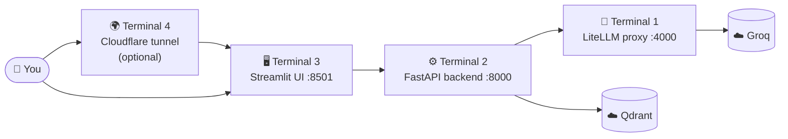
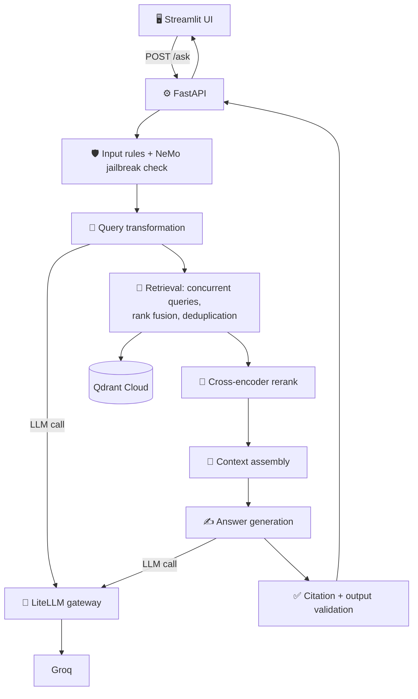

<div align="center">

# ⚡ FastAPI Production RAG

### A grounded documentation assistant for FastAPI
Ask a question → get an answer **with citations** → or an honest *"I don't have enough evidence."*


[🚀 Quick Start](#-quick-start) · [🧠 How it works](#-how-it-works) · [🔌 API](#-api) · [🌍 Share it](#-share-it-publicly) · [🛠️ Troubleshooting](#️-troubleshooting)

</div>

---

## ✨ Highlights

| | Feature | What it means |
|---|---|---|
| 🔎 | **Grounded answers** | Every answer is built only from retrieved documentation |
| 📌 | **Verified citations** | Citations are checked against the evidence the model was given |
| 🛡️ | **Layered safety** | Input rules, NeMo jailbreak heuristics, output validation |
| 🧭 | **Smart query handling** | Picks a strategy per question: direct, rewrite, multi-query, HyDE, decompose |
| 🎯 | **Two-stage retrieval** | Vector search, rank fusion, then cross-encoder reranking |
| 🔀 | **Model gateway** | LiteLLM with fallbacks, so models can change without code changes |
| ⏱️ | **Per-stage timing** | `latency_ms` shows exactly where time is spent |

**Stack:** FastAPI · Streamlit · Qdrant Cloud · LiteLLM · Groq · NeMo Guardrails

📖 Deeper reading: [`flow.md`](flow.md) explains how a request moves through the system. [`decision.md`](decision.md) records the issues met and the trade-offs made.

---

## 🚀 Quick Start

You will run **four terminals**. Think of them as four small programs that talk to each other:



### 📋 Step 0: What you need

| Requirement | Why | Check it |
|---|---|---|
| Git | Clone the repo | `git --version` |
| Python 3.12 | Backend and frontend | `python --version` |
| Docker Desktop | Runs the LiteLLM proxy | `docker --version` |
| Groq API key | The language model | free at [console.groq.com](https://console.groq.com) |
| Qdrant Cloud cluster + key | Stores the indexed documentation | free tier at [cloud.qdrant.io](https://cloud.qdrant.io) |
| Cloudflared *(optional)* | Public link to the UI | `cloudflared --version` |

<details>
<summary><b>🐳 Step 1: Install Docker (skip if you already have it)</b></summary>

<br>

**Windows**
```powershell
winget install Docker.DockerDesktop
```
Restart if asked, open **Docker Desktop**, and wait until it says *Engine running*. Windows needs WSL 2, so accept the prompt if it appears.

**macOS**
```bash
brew install --cask docker
```
Open Docker from Applications and wait until it is running.

**Linux (Ubuntu)**
```bash
sudo apt update && sudo apt install -y docker.io docker-compose-v2
sudo usermod -aG docker $USER   # log out and back in afterwards
```

**Verify**
```bash
docker --version
docker compose version
```

</details>

### 📦 Step 2: Clone and install

```bash
git clone https://github.com/UmairDevloper/FastAPI-Production-RAG.git
cd FastAPI-Production-RAG
python -m venv .venv
```

| System | Activate the environment |
|---|---|
| 🪟 Windows PowerShell | `.venv\Scripts\activate` |
| 🍎 macOS / 🐧 Linux | `source .venv/bin/activate` |

```bash
pip install -r requirements.txt
pip install -r fastapi_rag_streamlit_ui/requirements.txt
```

### 🔑 Step 3: Create the `.env` file

Create `.env` in the **project root** (next to `requirements.txt`):

```ini
LITELLM_MASTER_KEY=choose-any-long-random-string
LITELLM_BASE_URL=http://localhost:4000/v1
GROQ_API_KEY=your-groq-key
QDRANT_ENDPOINT=https://your-cluster-url:6333
QDRANT_API_KEY=your-qdrant-key
QDRANT_COLLECTION_NAME=your-collection-name
```

> ⚠️ The Qdrant collection must already contain the indexed documentation. Never commit `.env`.

### 🐳 Step 4: Terminal 1, start the LiteLLM proxy

Make sure Docker Desktop is running, then:

```bash
cd app/docker/litellm
docker compose up -d
```

Docker pulls the LiteLLM image the first time. It is the only image this project needs, and there is nothing to build. Wait about 30 seconds, then check:

```bash
docker logs --tail 5 litellm-proxy
```

✅ You want to see: `Uvicorn running on http://0.0.0.0:4000`

> 💡 Error `env file ... .env not found`? The compose file in `app/docker/litellm/` must read the root `.env`:
> ```yaml
>     env_file:
>       - ../../../.env
> ```

### ⚙️ Step 5: Terminal 2, start the backend

Open a **new terminal** in the project root, activate the environment, then:

```bash
uvicorn app.main:app --port 8000
```

The first start downloads the embedding and reranker models. Wait for the pipeline-initialized message, then check:

```bash
curl http://localhost:8000/health
```

📚 Interactive API docs: `http://localhost:8000/docs`

### 🖥️ Step 6: Terminal 3, start the frontend

Open a **new terminal** in the project root, activate the environment, then:

```bash
streamlit run fastapi_rag_streamlit_ui/streamlit_app.py
```

Open `http://localhost:8501`, click **Check API health** in the sidebar, and ask your first question. 🎉

### 🌍 Step 7: Terminal 4, get a public URL *(optional)*

<a id="-share-it-publicly"></a>

Share the UI with anyone, for free, while your computer stays on.

| System | Install cloudflared |
|---|---|
| 🪟 Windows | `winget install Cloudflare.cloudflared` |
| 🍎 macOS | `brew install cloudflared` |
| 🐧 Linux | download from the cloudflared releases page on GitHub |

Open a **new** terminal after installing (so the command is found), then point the tunnel at the **UI**:

```bash
cloudflared tunnel --url http://localhost:8501
```

After a few seconds a box appears with your link:

```
https://random-words-here.trycloudflare.com
```

Open it in any browser or on your phone. 📱

> ⚠️ Keep this terminal open, because closing it ends the link. The address changes every time you restart the tunnel. Free Groq limits apply, so ask one question at a time.

### 🛑 Step 8: Stop everything

| Terminal | How to stop |
|---|---|
| Backend, frontend, Cloudflare | `Ctrl + C` |
| Docker | `cd app/docker/litellm && docker compose down` |

---

## 🧠 How it works



The request path in one line: **validate → pick a search strategy → retrieve → fuse → rerank → build context → generate → verify citations.** Four early exits (blocked input, jailbreak, clarify, out of scope) return before any answer is generated. See [`flow.md`](flow.md) for the full sequence.

---

## 🔌 API

**`GET /health`** returns service status.

**`POST /ask`**
```json
{ "question": "How do I add OAuth2 to FastAPI?" }
```

The question must be 1 to 2000 characters.

| Field | Meaning |
|---|---|
| `answer` | Generated answer with evidence citations |
| `citations` | Evidence actually cited (url, page title, heading path) |
| `insufficient_evidence` | `true` when nothing could ground an answer |
| `latency_ms` | Per-stage timings, useful for finding slow stages |

```bash
curl -X POST http://localhost:8000/ask \
  -H "Content-Type: application/json" \
  -d '{"question":"How do I add OAuth2 to FastAPI?"}'
```

---

## ⚙️ Configuration

| Variable | Purpose |
|---|---|
| `LITELLM_MASTER_KEY` | Key shared by the API and the LiteLLM proxy |
| `LITELLM_BASE_URL` | Proxy URL, for example `http://localhost:4000/v1` |
| `GROQ_API_KEY` | Groq credentials, used by the proxy |
| `QDRANT_ENDPOINT` | Qdrant Cloud URL |
| `QDRANT_API_KEY` | Qdrant credentials |
| `QDRANT_COLLECTION_NAME` | Collection holding the indexed documentation |
| `LOGFIRE_TOKEN` | Optional observability token |
| `RAG_LOG_QUERIES` | Set `true` to log user queries (default off) |
| `RAG_API_BASE_URL` | UI only: backend address (default `http://127.0.0.1:8000`) |

---

## 🗂️ Project Layout

```
app/
├── main.py                  API entry point (/ask, /health)
├── config.py                Settings and environment variables
├── security/                Input/output rules and NeMo guardrails config
├── query_transformation/    Strategy selection (direct, rewrite, multi-query, HyDE, decompose)
├── retrieval/               Retriever, orchestrator, fusion, deduplication, context assembly
├── generation/              Pipeline, prompts, answer generation, citation validation
├── llm_gateway/             Client for the LiteLLM proxy
├── docker/litellm/          LiteLLM config and compose file
└── ingestion/, indexing/    Documentation ingestion and Qdrant indexing
evaluation/                  Evaluation datasets, runners and reports
fastapi_rag_streamlit_ui/    Streamlit frontend
tests/                       Tests
```

---

## 🌐 Deployment options

| Option | Cost | Notes |
|---|---|---|
| **Your PC + Cloudflare Tunnel** | Free | Easiest, covered in Step 7. Only up while your PC is on |
| **Free cloud VM + Docker Compose** | Free tier | Always on. Run the API and LiteLLM as two services, set `LITELLM_BASE_URL=http://litellm:4000/v1`, and point the NeMo `base_url` at `http://litellm:4000/v1` |
| **Streamlit Community Cloud** | Free | Host only the UI from `fastapi_rag_streamlit_ui/`, with `RAG_API_BASE_URL` set to your API address |

> ℹ️ Hugging Face Docker Spaces may not be available on free accounts, so this project does not rely on them. Free hosts with about 512 MB of RAM are too small for the local embedding and reranker models.

---

## 🔒 Security Notes

- 🔐 Add authentication or rate limiting to `/ask` before exposing it publicly, otherwise anyone can use up your LLM quota.
- 🗝️ Keep all keys in `.env` or platform secrets, never in the repository.
- 🚫 NeMo guardrails fail closed: an error in the check blocks the request.

---

## 📝 Known Behaviour

- ⏳ **Groq free-tier limits are tight.** The token-per-minute cap can return `429` if questions come in quickly. Ask one at a time, or spread tasks across different Groq models in the LiteLLM config.
- 🖥️ **Local CPU models are too slow here.** A local model cannot process long grounded prompts in time on CPU, so use hosted models for both primary and fallback.
- ⏱️ **Timeouts must be layered.** Inner timeouts stay shorter than outer ones (gateway 45s, client 120s), otherwise fallbacks never trigger.
- 🧩 **Provider settings belong in the gateway.** Model parameters such as reasoning effort go in the LiteLLM config, not in application code.

---

## 🛠️ Troubleshooting

| Problem | Fix |
|---|---|
| `docker: command not found` or engine not running | Start Docker Desktop and wait for *Engine running* |
| `.env not found` in Docker | Fix the `env_file` path in Step 4 |
| `429 Too Many Requests` in the proxy log | Groq free-tier limit. Wait a minute and ask one question at a time |
| A request takes about 50 seconds, then fails | The model fallback timed out. Check `docker logs --tail 40 litellm-proxy` |
| UI cannot reach the API | The backend terminal stopped. Restart Step 5 |
| `cloudflared` not recognized | Open a new terminal, or run it by its full path |
| **Check API health** fails | Confirm `http://localhost:8000/health` works first |

---

## 🧪 Testing and Evaluation

```bash
pip install -r requirements-dev.txt
pytest
```

Evaluation datasets, runners and reports live under `evaluation/`.

---

<div align="center">

Built with ⚡ FastAPI · 🔎 Qdrant · 🔀 LiteLLM · 🛡️ NeMo Guardrails

⭐ If this project helped you, consider starring the repo.

</div>
