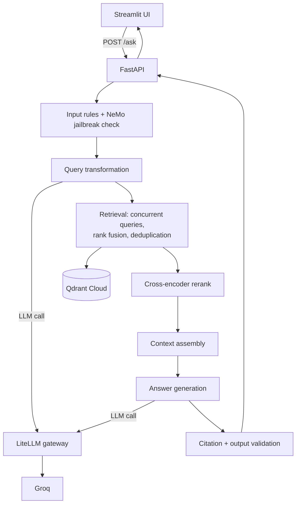

# FastAPI Production RAG

A grounded documentation assistant for FastAPI. It answers questions from indexed FastAPI documentation, cites the evidence it used, and refuses to answer when the evidence is insufficient.

- **Backend:** FastAPI service exposing `POST /ask` and `GET /health`
- **Frontend:** Streamlit chat UI (`fastapi_rag_streamlit_ui/`)
- **Vector store:** Qdrant Cloud
- **LLM access:** LiteLLM gateway in front of Groq (and an optional local Ollama model)
- **Safety:** input rules, NeMo Guardrails jailbreak heuristics, output and citation validation

See [`flow.md`](flow.md) for how a request moves through the system and [`decision.md`](decision.md) for the issues met and the trade-offs made.

---

## Architecture



## Project Layout

```
app/
  main.py                  API entry point (/ask, /health)
  config.py                Settings and environment variables
  security/                Input/output rules and NeMo guardrails config
  query_transformation/    Strategy selection (direct, rewrite, multi-query, HyDE, decompose)
  retrieval/               Retriever, orchestrator, fusion, deduplication, context assembly
  generation/              Pipeline, prompts, answer generation, citation validation
  llm_gateway/             Client for the LiteLLM proxy
  docker/litellm/          LiteLLM config files and compose file
  ingestion/, indexing/    Documentation ingestion and Qdrant indexing
evaluation/                Evaluation datasets, runners and reports
fastapi_rag_streamlit_ui/  Streamlit frontend
tests/                     Tests
```

## Requirements

- Python 3.12
- A Qdrant Cloud cluster with the documentation already indexed
- A Groq API key
- Docker (for the LiteLLM proxy)

## Configuration

Create a `.env` file in the project root. Never commit it.

| Variable | Purpose |
|---|---|
| `LITELLM_MASTER_KEY` | Key shared by the API and the LiteLLM proxy |
| `LITELLM_BASE_URL` | Proxy URL, for example `http://localhost:4000/v1` |
| `GROQ_API_KEY` | Groq credentials, used by the proxy |
| `QDRANT_ENDPOINT` | Qdrant Cloud URL |
| `QDRANT_API_KEY` | Qdrant credentials |
| `QDRANT_COLLECTION_NAME` | Collection holding the indexed documentation |
| `LOGFIRE_TOKEN` | Optional observability token |
| `RAG_LOG_QUERIES` | Set `true` to log user queries (default off) |

## Run Locally

**1. Install dependencies**
```bash
python -m venv .venv
# Windows:  .venv\Scripts\activate      Linux/macOS:  source .venv/bin/activate
pip install -r requirements.txt
```

**2. Start the LiteLLM proxy**
```bash
cd app/docker/litellm
docker compose up -d
```
The proxy listens on `localhost:4000`. Wait about 30 seconds for it to finish starting.

**3. Start the API** (from the project root)
```bash
uvicorn app.main:app --port 8000
```
Open `http://localhost:8000/docs`.

**4. Start the Streamlit UI**
```bash
pip install -r fastapi_rag_streamlit_ui/requirements.txt
streamlit run fastapi_rag_streamlit_ui/streamlit_app.py
```
The UI reads the API address from `RAG_API_BASE_URL` (default `http://127.0.0.1:8000`).

## API

**`GET /health`** returns service status.

**`POST /ask`**
```json
{ "question": "How do I add OAuth2 to FastAPI?" }
```
The question must be 1 to 2000 characters. The response contains:

| Field | Meaning |
|---|---|
| `answer` | Generated answer with evidence citations |
| `citations` | Evidence actually cited (url, page title, heading path) |
| `insufficient_evidence` | `true` when the system found nothing to ground an answer |
| `latency_ms` | Per-stage timings, useful for finding slow stages |

Example:
```bash
curl -X POST http://localhost:8000/ask \
  -H "Content-Type: application/json" \
  -d '{"question":"How do I add OAuth2 to FastAPI?"}'
```

## Deployment

### Hugging Face Spaces (Docker, single container)

The YAML block at the top of this file is the Space configuration (`sdk: docker`, `app_port: 7860`). In this mode the container runs both LiteLLM (port 4000) and the API (port 7860).

1. Use `app/docker/litellm/litellm_config.prod.yaml` (Groq only, no Ollama) as the proxy config.
2. Create a Docker Space and push this repository to it.
3. In **Settings → Variables and secrets**, add the variables from the Configuration table. Set `LITELLM_BASE_URL` to `http://localhost:4000/v1`.
4. Open `https://<user>-<space-name>.hf.space/docs` once the build finishes.

The free tier sleeps when idle, and the first request after waking is slow while models load.

### Docker Compose on a VM

A root-level `docker-compose.yml` runs the API and LiteLLM as two services, with `LITELLM_BASE_URL=http://litellm:4000/v1` for the API. In that setup the NeMo `base_url` must point to `http://litellm:4000/v1` instead of `localhost`.

### Streamlit UI

Deploy `fastapi_rag_streamlit_ui/` on Streamlit Community Cloud, with `streamlit_app.py` as the main file. Set the environment variable `RAG_API_BASE_URL` in the app settings to your deployed API URL (no trailing slash).

## Security Notes

- Add API authentication or rate limiting to `/ask` before exposing it publicly, otherwise anyone can consume your LLM quota.
- Keep all keys in environment variables or platform secrets, never in the repository.
- NeMo guardrails fail closed: an error in the check blocks the request.

## Known Behaviour

- The local Ollama fallback is for development only. On CPU it cannot process long prompts in time, so production should use hosted models for both primary and fallback.
- Inner timeouts must stay shorter than outer ones (gateway 45s, client 120s), otherwise fallbacks never trigger.
- Provider-specific model parameters belong in the gateway config, not in application code.

## Testing and Evaluation

```bash
pip install -r requirements-dev.txt
pytest
```
Evaluation datasets, runners and reports live under `evaluation/`.