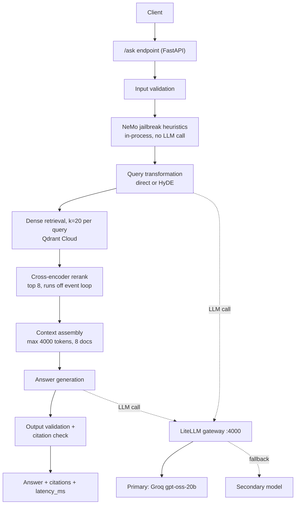
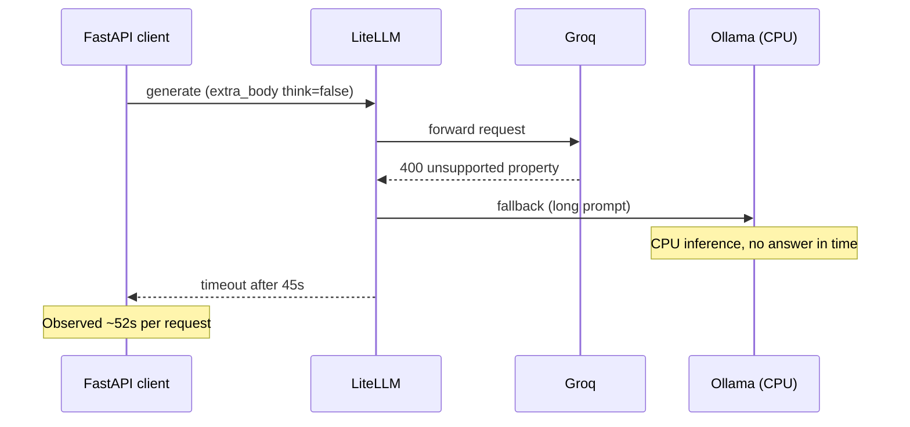

# Design Decisions, Issues and Trade-offs

This document records the problems met while building and testing the FastAPI Production RAG service, the trade-offs behind the architecture, and how each was resolved. It is a decision log, not a tutorial.

---

## 1. System Flow

**Why this shape:** every stage after security narrows the evidence (20 candidates, then 8, then a token budget) so the generation prompt stays small and grounded. Each stage reports its own timing so the slow stage is identifiable.

---

## 2. Issue Log

| # | Symptom | Root cause | Resolution |
|---|---------|------------|------------|
| 1 | Request 1 succeeds, requests 2 and 3 end in "Request timed out" at the generation step | Generation ran on a local Ollama `qwen3:8b` with `100% CPU` and a 4096 context. Short prompts (query transform) finished; the long grounded prompt did not | Moved generation to a hosted model (Groq) as primary; local model demoted to fallback |
| 2 | Fallback model never rescued the request | Client timeout (180s) equalled the gateway timeout (180s), so the caller gave up before the gateway could fail over | Gateway `request_timeout` lowered to 45s, retries set to 0; client timeout kept higher |
| 3 | Groq returned `property 'think' is unsupported` | `reasoning_effort: none` is a local-model setting; Groq only accepts low, medium or high | Groq entries use `reasoning_effort: low`; `none` kept only on local entries |
| 4 | Same error persisted after the config fix | `client.py` sent `extra_body={"think": False}` on every call; `drop_params` does not remove `extra_body` fields | Removed the `extra_body` line; per-model reasoning is controlled only in the gateway config |
| 5 | Config edits seemed ignored | Needed to confirm the container used the edited file | Verified the bind mount (`litellm_config.yaml` to `/app/config.yaml`) and printed the live config |
| 6 | Latent crash on empty LLM output | `from fastapi import logger` is the wrong import and fails when the error path runs | Replace with `logging.getLogger(__name__)` |

### Failure chain for issues 3 and 4

---

## 3. Trade-offs

### 3.1 Local LLM vs hosted LLM

| | Local (Ollama) | Hosted (Groq) |
|---|---|---|
| Cost | Free | Free tier, rate limited |
| Latency on long prompts | Minutes on CPU | Seconds |
| Privacy | Data stays local | Prompts leave the machine |
| Reliability | Depends on own hardware | Depends on provider limits |

**Decision:** hosted model as primary, local as fallback. Generation is the only step with a large prompt, so it is the step that most needs speed.

### 3.2 LLM gateway (LiteLLM) vs direct provider calls

| | Gateway | Direct |
|---|---|---|
| Model swap without code change | Yes | No |
| Fallbacks and timeouts in one place | Yes | Must be coded |
| Extra moving part and failure surface | Yes | No |

**Decision:** keep the gateway. The cost was real (issues 2 to 5 all lived in the gateway layer), but model aliases such as `rag-generation` let providers change without touching application code.

### 3.3 Timeout and fallback strategy

Rule: **inner timeouts must be shorter than outer ones.** Otherwise the outer layer fails first and fallbacks are dead code. The trade-off is that a slow but valid answer may be cut at 45s.

### 3.4 Security layers

| Layer | Strength | Cost |
|---|---|---|
| Rule-based input validation | Fast, deterministic | Misses novel attacks |
| NeMo jailbreak heuristics | Adds a second check, no LLM call (about 0.6s) | Fails closed: any NeMo error blocks the request |
| Output validation and citation check | Rejects answers citing unknown evidence | Can reject otherwise usable answers |

**Decision:** fail closed. A blocked valid request is cheaper than an unsafe answer passing through.

### 3.5 Retrieval depth vs prompt size

Retrieving 20 candidates and reranking to 8 improves recall, but every extra document grows the generation prompt. A 4000-token context budget caps this. Raising it improves coverage but directly increases generation latency, which was the original failure point.

### 3.6 Deployment on free infrastructure

| Option | Fits this project? | Limitation |
|---|---|---|
| 512 MB free web hosts | No | Local embedding and reranker models need more memory |
| Hugging Face Spaces | Possibly | Single container, sleeps when idle, free-tier terms must be checked |
| Always-free cloud VM + Docker Compose | Yes | Account verification, manual operation |

**Decision:** run the API and gateway with Docker Compose on a free VM. Qdrant and Groq stay hosted. The local Ollama model is dropped in production because there is no free GPU to run it.

---

## 4. Lessons

1. Measure per stage first. The `latency_ms` breakdown showed retrieval was healthy and generation was the bottleneck.
2. Compare a short prompt against a long one before blaming the network. The difference exposed CPU-bound inference.
3. Provider-specific parameters (`think`, `reasoning_effort`) do not travel between providers. Keep them in gateway config, not application code.
4. Fallbacks only work if timeouts are layered correctly.
5. Verify what the running container actually loaded, not what is on disk.

---

## 5. Open Items

- Add authentication and rate limiting on `/ask` before public exposure.
- Replace the local fallback with a second hosted model for production.
- Add a regression test that issues three consecutive `/ask` calls and asserts each completes under a set latency.
- Fix the `logger` import in `app/llm_gateway/client.py`.
