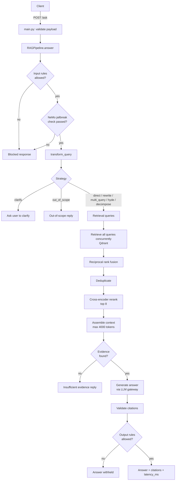
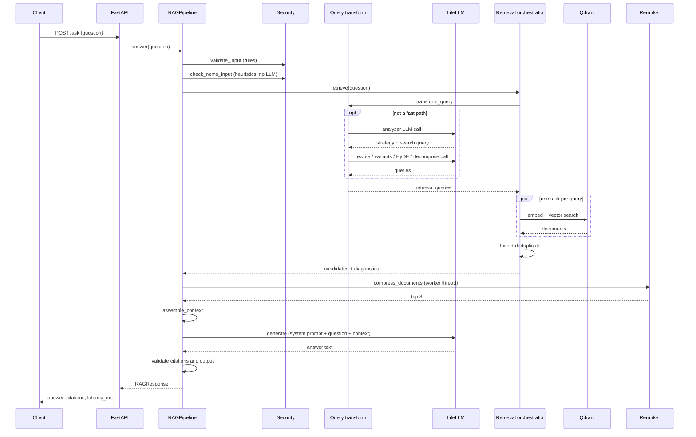
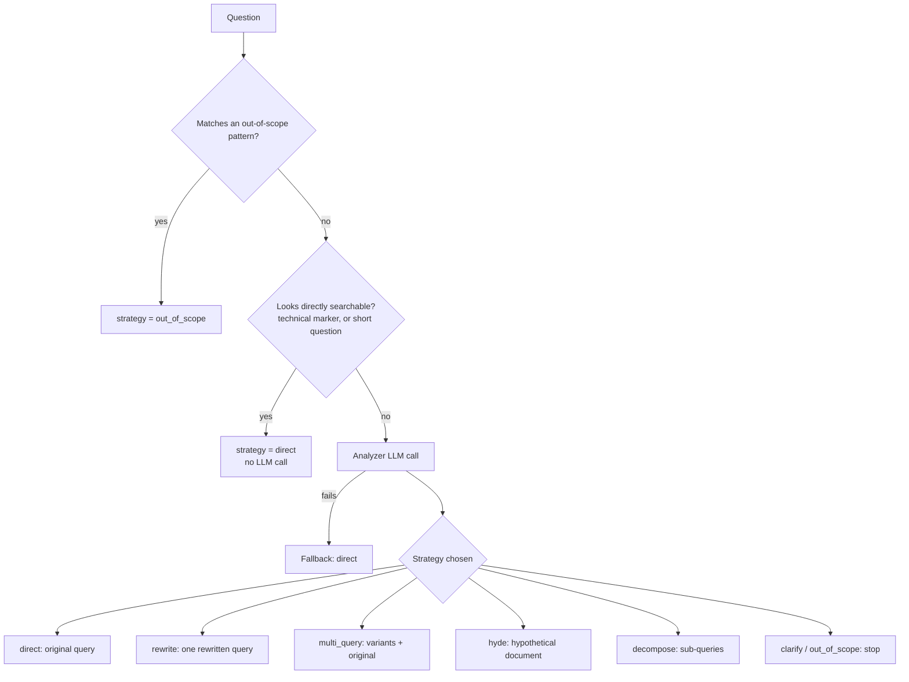
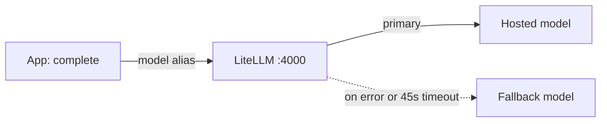

# Request Flow: Orchestration, Data and Events

This document explains how one request moves through the service: who calls whom, what data is passed, what events and decisions occur, and how the final answer is produced. Names refer to the code under `app/`.

---

## 1. Components and Responsibilities

| Component | File | Role |
|---|---|---|
| API layer | `main.py` | Receives `POST /ask`, validates the payload, maps errors to HTTP codes |
| Pipeline | `generation/rag_pipeline.py` | Top-level orchestrator. Runs every stage in order and records timings |
| Query transformation | `query_transformation/service.py` | Decides the retrieval strategy and produces the search queries |
| Retrieval orchestrator | `retrieval/orchestrator.py` | Runs queries concurrently, fuses and deduplicates results |
| Retriever | `retrieval/retriever.py` | Embeds a query and searches Qdrant |
| Reranker | `CrossEncoderCompressor` | Scores candidates against the question and keeps the best |
| Context assembly | `retrieval/context_assembly.py` | Builds the evidence block within a token budget |
| Answer generation | `generation/answer_generation.py` | Builds the prompt, calls the LLM, validates citations |
| LLM gateway | `llm_gateway/client.py` + LiteLLM | Single entry point to the language models |
| Security | `security/` | Input rules, NeMo jailbreak check, output rules |

---

## 2. End-to-End Flow



Four exits return before any answer generation: input blocked, NeMo blocked, clarify, and out of scope. They are cheap by design, because the LLM is never called for them.

---

## 3. Event Sequence for a Normal Request



---

## 4. Stage-by-Stage Data Flow

### 4.1 Request and security
- Input: `{"question": "..."}`, length 1 to 2000 characters.
- The question is trimmed. Empty input raises a 422.
- `validate_input` applies deterministic rules. `check_nemo_input` runs NeMo's jailbreak heuristics in-process, with no LLM call. NeMo is **fail closed**: if it errors, the request is treated as blocked.

### 4.2 Query transformation (decides what to search)



Two fast paths avoid an LLM call. The "direct" check is case-sensitive on the prefixes `How do I `, `What is `, `How to `, or a question mark. A lowercase question such as "how to enable OAuth in fastapi" does not match and goes to the analyzer.

If the analyzer fails, the system falls back to direct retrieval instead of failing the request.

### 4.3 Retrieval, fusion and deduplication
1. Queries are cleaned: empty and duplicate ones removed, order kept. For HyDE, the hypothetical document replaces the query as the search input. It is never shown to the user as evidence. If nothing remains, the original question is used.
2. Every query runs as its own task with `asyncio.gather(..., return_exceptions=True)`. One failing query does not fail the request. Failures are counted in diagnostics.
3. Results from the successful queries are merged with **reciprocal rank fusion**. Each document scores `1 / (k + rank)` per list (default `k = 60`) and the scores add up, so a document found by several queries rises.
4. `deduplicate_documents` removes repeats using a SHA-256 based document id.

### 4.4 Reranking
The fused candidates (up to 20 per query) are scored against the question by a cross-encoder (`ms-marco-MiniLM-L-6-v2`) and cut to the top 8. This is CPU-heavy synchronous work, so it runs in `asyncio.to_thread` to keep the event loop free. With `fail_open=True`, a reranker error does not abort the request.

### 4.5 Context assembly
Reranked documents are formatted one by one as:

```
[<evidence_id>]
<source information and text>
```

separated by `---`. Blocks are added in rank order until adding the next one would pass the budget (4000 estimated tokens, 8 documents). The result is the context string plus the list of evidence items that made it in.

### 4.6 Answer generation
- No evidence: return the "could not find sufficient documentation" reply and mark `insufficient_evidence = true`. The LLM is not called.
- Otherwise the prompt is the system prompt plus the question plus `<context>...</context>`, with an instruction to cite using exact evidence identifiers.
- The call goes to the gateway with `model="rag-generation"`, temperature 0, `max_tokens=512`.

### 4.7 Validation and result
- Bracketed ids in the answer are matched against the supplied evidence. Exact ids and unambiguous unprefixed ids are accepted. Unknown or ambiguous ids raise an error, which prevents citations to sources the model was never given.
- Only evidence actually cited is returned as citation metadata (url, page title, heading path).
- `validate_output` can still withhold the answer.
- The response contains the answer, citations, `insufficient_evidence` and `latency_ms`.

---

## 5. LLM Gateway Path



The application only knows model aliases such as `rag-generation`. Which provider serves an alias, the timeouts and the fallbacks are all defined in the gateway config. LLM calls happen in two places: query transformation (analyzer, rewrite, variants, HyDE, decompose) and final generation.

---

## 6. Where Time Goes (`latency_ms`)

| Key | Covers |
|---|---|
| `security` | Input rules |
| `nemo_security` | NeMo heuristics (about 0.6s observed) |
| `retrieval` | Query transformation, retrieval, fusion and dedup together |
| `reranking` | Cross-encoder scoring |
| `context_assembly` | Evidence formatting |
| `generation` | LLM call and citation validation |
| `total` | Whole request |

A stage missing from this map means the request left the pipeline before reaching it.

---

## 7. Failure Handling Summary

| Stage | Failure | Behaviour |
|---|---|---|
| Input / NeMo | Blocked or NeMo error | Fixed blocked reply, no LLM call |
| Query analysis | Exception | Falls back to direct retrieval |
| One retrieval query | Exception | Counted and skipped, other queries continue |
| Reranker | Exception | Fail open, continues with unranked candidates |
| Generation | Provider error or timeout | Gateway fallback, then HTTP 500 |
| Citation check | Unknown or ambiguous id | Error, request fails with HTTP 500 |
| API layer | `ValueError` | HTTP 422 |
